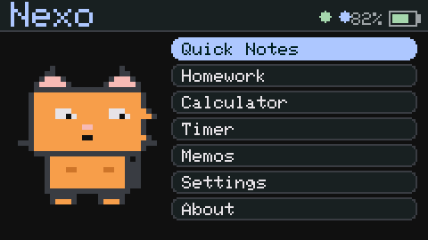
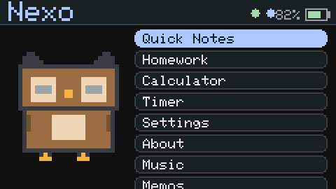
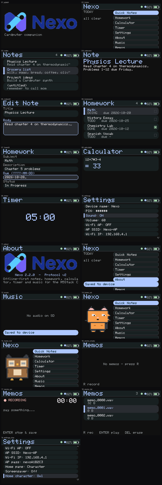

# Nexo

An offline-first study toolkit for the **M5Stack Cardputer** (Stamp-S3A) with a
companion phone/desktop app (Flutter, Android + macOS) that talks to the device
over **Bluetooth Low Energy**.

The Cardputer firmware is a standalone application image that can be chain-loaded
by [bmorcelli/Launcher](https://github.com/bmorcelli/Launcher). The app keeps a
local cache of the device's notes and homework, lets you edit them offline, and
pushes/pulls changes over a small, documented BLE protocol.

> **Website:** <https://nexo-6oa.pages.dev/> — downloads, docs, terms and privacy.

> **Status:** working release, tested on real hardware.
> Built and flashed to a physical **M5Stack Cardputer-Adv**; boot, the on-device UI,
> voice memos, BLE and Wi-Fi features were verified on-device.
> Native unit tests pass. See `docs/TROUBLESHOOTING.md` for known issues.

<p align="center">
  
  
</p>

A few more screens (Notes, Homework, Calculator, Timer, Settings, Memos):

<p align="center">
  
</p>

## Repository layout

```
Nexo/
├── docs/
│   ├── PROTOCOL.md         # BLE wire protocol (source of truth)
│   ├── BUILD.md            # how to build firmware + app
│   └── TROUBLESHOOTING.md  # known issues and fixes
├── firmware/               # PlatformIO project (ESP32-S3)
│   ├── lib/nexo_core/      # portable, host-tested protocol core
│   ├── src/                # device layer (BLE, Wi-Fi, UI, storage)
│   ├── test/test_core/     # native unit tests
│   ├── platformio.ini
│   └── partitions.csv
├── app/                    # Flutter app (Android + macOS)
│   ├── lib/protocol/       # Dart port of the wire protocol
│   ├── lib/models/         # Note / Homework / Settings
│   ├── lib/ble/            # flutter_blue_plus client
│   ├── lib/state/          # AppState (sync engine)
│   └── lib/screens/        # UI
├── website/                # static info site + WASM emulator (Cloudflare Pages)
└── dist/                   # build artifacts
    ├── firmware/Nexo-m5stack-cardputer.bin
    └── app/Nexo-android-release.apk
```

## Features

**Cardputer firmware**
- Notes (title + body) and Homework (subject, description, due date, status).
- On-device UI: Home, Notes, Note view/edit, Homework, Homework edit,
  Calculator, Timer, Memos, Settings, About.
- Voice memos: record to `/memos` on the SD card as 16 kHz mono WAV and play
  them back right on the device.
- Home pane shows a little animated 8-bit character (orange cat or owl (8-bit owl)),
  selectable in Settings.
- LittleFS persistence with atomic writes.
- BLE GATT server (NimBLE) implementing the Nexo protocol with PIN auth.
- Optional Wi-Fi access point serving a small built-in web UI (no CDN/cloud)
  plus an HTTP API for bulk transfers and over-the-air firmware updates.
- Material-3-inspired dark UI tuned for the 240×135 display.

**Companion app**
- Scan/connect/authenticate to a Nexo device over BLE.
- Browse, search, create, edit, and delete notes and homework.
- Offline-first local cache; changes are marked *dirty* and pushed on sync.
- Sync engine with revisions, tombstones, and conflict resolution.
- Device dashboard (battery, storage, Wi-Fi, uptime), extended settings with
  live time sync, and find/reboot/factory-reset actions.
- One-tap firmware updates over the device's Wi-Fi AP.
- Self-update: checks GitHub Releases on launch and installs a newer build in
  one tap (Android) or one click (macOS).
- Material 3 (Material You) theming, light/dark, phone and desktop layouts.

## Quick start

**Pairing:** the firmware ships with the default PIN **123456**. Enter it in the
app on first connect; you can change it later under the app's **Settings** tab.

Build the firmware image (for Launcher or a raw flash):

```bash
cd firmware
export PATH="$HOME/Library/Python/3.13/bin:$PATH"
pio run -e m5stack-cardputer          # -> .pio/build/m5stack-cardputer/firmware.bin
pio test -e native                    # run the portable core tests
```

Build the app:

```bash
cd app
flutter pub get
flutter test
flutter build macos --release         # macOS app
flutter build apk --release           # Android APK
```

See `docs/BUILD.md` for details and `docs/PROTOCOL.md` for the wire format.
Prebuilt firmware and apps are on the [website](https://nexo-6oa.pages.dev/)
and the [latest release](https://github.com/apiwishboon-spec/Nexo/releases/latest).
Try the firmware UI in your browser at the
[emulator](https://nexo-6oa.pages.dev/emulator) (the real `ui.cpp`, compiled to
WebAssembly).

## License

Copyright (C) 2026 Apiwish Anutravanichkul.

Nexo is free software: you can redistribute it and/or modify it under the terms
of the **GNU Affero General Public License** as published by the Free Software
Foundation, either version 3 of the License, or (at your option) any later
version. See [`LICENSE`](LICENSE) for the full text.
